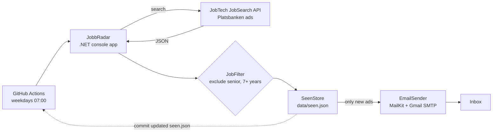
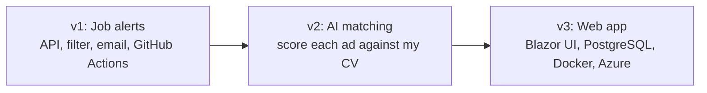

# JobbRadar

Daily job alerts for .NET developer roles in Stockholm. JobbRadar fetches new ads from Platsbanken through the JobTech JobSearch API, filters out what doesn't fit, and emails a short list every weekday morning – fully automated with GitHub Actions, no server needed.

**Status:** Version 1 in progress.

## How it works



1. A scheduled GitHub Actions workflow starts the app every weekday morning.
2. `JobTechClient` searches Platsbanken for .NET roles in Stockholm.
3. `JobFilter` removes ads with excluded words, such as "senior" or "7+ years".
4. `SeenStore` keeps track of ads already sent, so each ad is only emailed once.
5. `EmailSender` sends a summary with title, employer, location, deadline and link.

## Tech stack

| Area | Choice | Why |
| --- | --- | --- |
| Language | C# / .NET 10 | Modern, typed and my main stack |
| Data source | JobTech JobSearch API | Open API for Platsbanken – no scraping |
| HTTP and JSON | HttpClient + System.Text.Json | Built into .NET, no extra dependencies |
| Email | MailKit via Gmail SMTP | The standard way to send email from .NET |
| Tests | xUnit | Unit tests for the filtering logic |
| Scheduling | GitHub Actions (cron) | Free, runs in the cloud, doubles as CI |
| State | JSON file in the repo | Simple enough for v1 – no database needed |

## Project structure

```text
jobbradar/
├─ .github/workflows/daily.yml
├─ src/JobbRadar/
│  ├─ Program.cs
│  ├─ appsettings.json
│  ├─ Models/JobAd.cs
│  └─ Services/
│     ├─ JobTechClient.cs
│     ├─ JobFilter.cs
│     ├─ SeenStore.cs
│     └─ EmailSender.cs
├─ tests/JobbRadar.Tests/
├─ data/seen.json
└─ README.md
```

## Getting started

```bash
git clone https://github.com/afffehh/jobbradar.git
cd jobbradar
dotnet test
dotnet run --project src/JobbRadar
```

Search words, region and excluded words are set in `src/JobbRadar/appsettings.json`.

## Secrets

Credentials are never stored in the code. Locally they are read from environment variables, and in GitHub Actions from repository secrets.

| Secret | Description |
| --- | --- |
| `SMTP_USER` | Gmail account that sends the email |
| `SMTP_PASSWORD` | Gmail app password for that account |
| `MAIL_TO` | Address that receives the daily list |

## Roadmap



- **v1 – Job alerts:** fetch, filter and email new .NET jobs every weekday.
- **v2 – AI matching:** score each ad 1–10 against my CV with an AI API and sort the email by match.
- **v3 – Web app:** a Blazor dashboard to track applications, backed by PostgreSQL, containerised with Docker and deployed to Azure.
