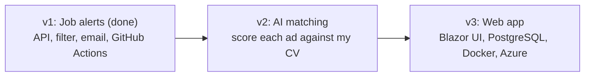
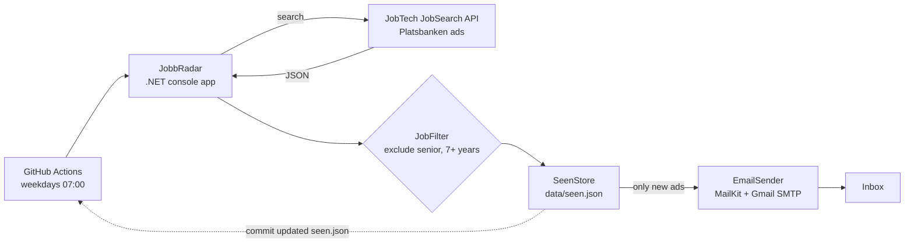
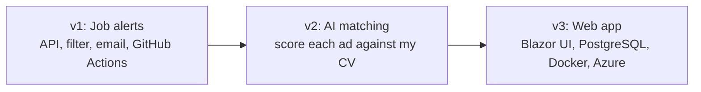

# JobbRadar

[](https://github.com/afffehh/jobbradar/actions/workflows/ci.yml)
[](https://github.com/afffehh/jobbradar/actions/workflows/daily.yml)

Daily job alerts for .NET developer roles in Stockholm. JobbRadar fetches new ads from Platsbanken through the JobTech JobSearch API, filters out what doesn't fit, and emails a short list of new matches every weekday morning – fully automated with GitHub Actions, no server needed.

**Status:** Version 1 is live and runs every weekday at 07:00 (Swedish time).

## How it works


1. A scheduled GitHub Actions workflow runs the tests and starts the app every weekday morning.
2. `JobTechClient` searches Platsbanken for .NET roles in Stockholm county.
3. `JobFilter` keeps only relevant ads:
   - the headline must contain a developer word, such as "utvecklare", "developer" or "engineer"
   - headlines with words like "senior", "lead" or "arkitekt" are excluded – also inside compound words
   - ads requiring more than 3 years of experience are excluded (read from the ad text, in Swedish and English)
   - ads past their application deadline are skipped
4. `SeenStore` remembers ads already sent, so each ad is only emailed once.
5. `EmailSender` sends an HTML email with title, employer, location, deadline and link.
6. The workflow commits the updated `data/seen.json` back to the repo as `jobbradar-bot`.

## Tech stack

| Area | Choice | Why |
| --- | --- | --- |
| Language | C# / .NET 10 | Modern, typed and my main stack |
| Data source | JobTech JobSearch API | Open API for Platsbanken – no scraping |
| HTTP and JSON | HttpClient + System.Text.Json | Built into .NET, no extra dependencies |
| Configuration | Microsoft.Extensions.Configuration | Settings in `appsettings.json`, secrets from environment variables |
| Email | MailKit via Gmail SMTP | The standard way to send email from .NET |
| Tests | xUnit | Unit tests for parsing, filtering, storage and email |
| CI/CD and scheduling | GitHub Actions | Tests on every PR, daily run in the cloud |
| State | JSON file in the repo | Simple enough for v1 – no database needed |

## Project structure

```text
jobbradar/
├─ .github/workflows/
│  ├─ ci.yml                  # tests on every pull request
│  └─ daily.yml               # scheduled daily run
├─ src/JobbRadar/
│  ├─ Program.cs
│  ├─ appsettings.json
│  ├─ Models/
│  │  ├─ JobAd.cs
│  │  ├─ JobSearchResponse.cs
│  │  └─ JobTechClient.cs
│  ├─ Services/
│  │  ├─ JobFilter.cs
│  │  ├─ SeenStore.cs
│  │  └─ EmailSender.cs
│  └─ Settings/
│     ├─ JobbRadarSettings.cs
│     └─ EmailSettings.cs
├─ tests/JobbRadar.Tests/
│  ├─ JobTechClientTests.cs
│  ├─ JobFilterTests.cs
│  ├─ SeenStoreTests.cs
│  ├─ EmailSenderTests.cs
│  └─ TestData/sample.json     # anonymised real API response
├─ data/seen.json
├─ docs/plan/plan-v1.md
└─ JobbRadar.slnx
```

## Getting started

```bash
git clone https://github.com/afffehh/jobbradar.git
cd jobbradar
dotnet test
dotnet run --project src/JobbRadar
```

Without email credentials the app does a dry run: it prints the new ads in the terminal and does not mark them as seen.

To send a real email locally, set the credentials as environment variables first (PowerShell):

```powershell
$env:SMTP_USER = "sender@gmail.com"
$env:SMTP_PASSWORD = "gmail-app-password"
$env:MAIL_TO = "you@example.com"
dotnet run --project src/JobbRadar
```

## Configuration

Search words, region, filters and email server are set in `src/JobbRadar/appsettings.json` – no code changes needed:

| Setting | Description |
| --- | --- |
| `Search.Query` | Free-text search, e.g. `.NET` |
| `Search.Region` | JobTech region concept ID (`CifL_Rzy_Mku` = Stockholm county) |
| `Search.Limit` | Max number of ads to fetch |
| `Filter.RequiredHeadlineWords` | The headline must contain at least one of these |
| `Filter.ExcludedHeadlineWords` | Ads with any of these in the headline are skipped |
| `Filter.MaxYearsRequired` | Max years of experience an ad may require |
| `SeenFile` | Path to the file with already sent ads |
| `Email.Host` / `Email.Port` | SMTP server |

## Secrets

Credentials are never stored in the code. Locally they are read from environment variables, and in GitHub Actions from repository secrets.

| Secret | Description |
| --- | --- |
| `SMTP_USER` | Gmail account that sends the email |
| `SMTP_PASSWORD` | Gmail app password for that account |
| `MAIL_TO` | Address that receives the daily list |

## Development workflow

Work is done in feature branches and merged through pull requests:

```text
feature/* → develop → main
```

Every pull request runs the test suite in CI. `main` is the released version that the scheduled workflow runs from. The plan for version 1 is in [docs/plan/plan-v1.md](docs/plan/plan-v1.md).

## Roadmap



- **v1 – Job alerts (done):** fetch, filter and email new .NET jobs every weekday.
- **v2 – AI matching:** score each ad 1–10 against my CV with an AI API and sort the email by match.
- **v3 – Web app:** a Blazor dashboard to track applications, backed by PostgreSQL, containerised with Docker and deployed to Azure.
# JobbRadar

Daily job alerts for .NET developer roles in Stockholm. JobbRadar fetches new ads from Platsbanken through the JobTech JobSearch API, filters out what doesn't fit, and emails a short list every weekday morning – fully automated with GitHub Actions, no server needed.

**Status:** Version 1 in progress.

## How it works



1. A scheduled GitHub Actions workflow starts the app every weekday morning.
2. `JobTechClient` searches Platsbanken for .NET roles in Stockholm.
3. `JobFilter` removes ads with excluded words, such as "senior" or "7+ years".
4. `SeenStore` keeps track of ads already sent, so each ad is only emailed once.
5. `EmailSender` sends a summary with title, employer, location, deadline and link.

## Tech stack

| Area | Choice | Why |
| --- | --- | --- |
| Language | C# / .NET 10 | Modern, typed and my main stack |
| Data source | JobTech JobSearch API | Open API for Platsbanken – no scraping |
| HTTP and JSON | HttpClient + System.Text.Json | Built into .NET, no extra dependencies |
| Email | MailKit via Gmail SMTP | The standard way to send email from .NET |
| Tests | xUnit | Unit tests for the filtering logic |
| Scheduling | GitHub Actions (cron) | Free, runs in the cloud, doubles as CI |
| State | JSON file in the repo | Simple enough for v1 – no database needed |

## Project structure

```text
jobbradar/
├─ .github/workflows/daily.yml
├─ src/JobbRadar/
│  ├─ Program.cs
│  ├─ appsettings.json
│  ├─ Models/JobAd.cs
│  └─ Services/
│     ├─ JobTechClient.cs
│     ├─ JobFilter.cs
│     ├─ SeenStore.cs
│     └─ EmailSender.cs
├─ tests/JobbRadar.Tests/
├─ data/seen.json
└─ README.md
```

## Getting started

```bash
git clone https://github.com/afffehh/jobbradar.git
cd jobbradar
dotnet test
dotnet run --project src/JobbRadar
```

Search words, region and excluded words are set in `src/JobbRadar/appsettings.json`.

## Secrets

Credentials are never stored in the code. Locally they are read from environment variables, and in GitHub Actions from repository secrets.

| Secret | Description |
| --- | --- |
| `SMTP_USER` | Gmail account that sends the email |
| `SMTP_PASSWORD` | Gmail app password for that account |
| `MAIL_TO` | Address that receives the daily list |

## Roadmap



- **v1 – Job alerts:** fetch, filter and email new .NET jobs every weekday.
- **v2 – AI matching:** score each ad 1–10 against my CV with an AI API and sort the email by match.
- **v3 – Web app:** a Blazor dashboard to track applications, backed by PostgreSQL, containerised with Docker and deployed to Azure.
